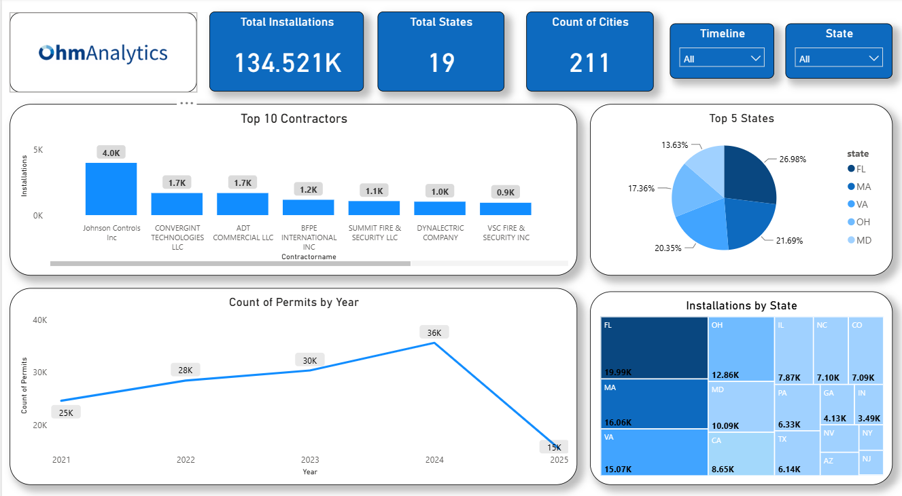
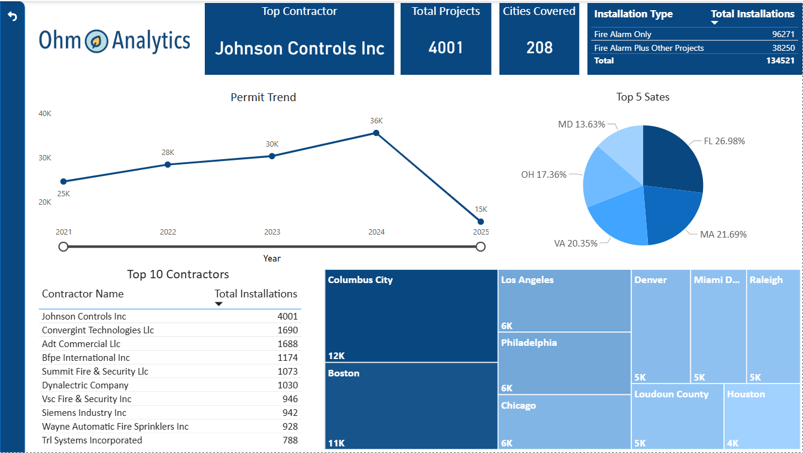

# US Fire Alarm Market Analysis Dashboard 🔥🚨

## Dashboard Views

### View 1

### View 2

# Introduction

This Power BI project analyzes the U.S. fire alarm installation market using permit data. The report has two views: one for contractors, installation types and cities, and one for a state-level overview with filters.

This was a professional project built at **Ohm Analytics**. **It is shared here with my manager's permission, and only the approved, aggregated view is shown**. Raw permit records, property addresses and the source data file are not included.

# Project Objectives 💡

- Measure the size of the U.S. fire alarm installation market by state and city.
- Split installations into **Fire Alarm Only** and **Fire Alarm Plus Other Projects**.
- Identify the top contractors and their share of installations.
- Track yearly permit trends to spot growth.
- Give business teams a simple, filterable view (by timeline and state) for market and sales analysis.

# Data Pipeline ⚙️

1. **Extract:** Pulled fire alarm permit data from SQL.
2. **Clean and transform:** Standardized contractor names, states, cities and dates, handled missing values, and removed duplicates.
3. **Load:** Imported the cleaned tables into Power BI.
4. **Model and visualize:** Built KPIs, charts and filters in Power BI.

Main fields used: contractor name, permit number, issue date, permit type and subtype, city, state, and project classification.

# Dashboard Features

### View 1
- **KPI cards:** Total installations, total states, count of cities
- **Top 10 Contractors:** bar chart
- **Top 5 States:** pie chart
- **Count of Permits by Year:** line chart
- **Installations by State:** treemap
- **Slicers:** Timeline and State

### View 2
- **KPI cards:** Top contractor, total projects of the top contractor, cities covered
- **Installation type table:** Fire Alarm Only vs Fire Alarm Plus Other Projects
- **Permit Trend:** yearly line chart, 2021 to 2025
- **Top 5 States:** pie chart of share of installations
- **Top 10 Contractors:** table ranked by total installations
- **City treemap:** installations by city

# Key Insights 📊

- The dashboard covers about **134.5K installations across 19 states and 200+ cities**.
- **About 72% of installations are Fire Alarm Only** (96,271), and about 28% are Fire Alarm Plus Other Projects (38,250).
- **Florida leads with about 20K installations**, followed by Massachusetts (16K), Virginia (15K), Ohio (12.9K) and Maryland (10.1K). These five states make up roughly 55% of all installations.
- **Columbus (about 12K) and Boston (about 11K) are the top cities**, ahead of Los Angeles, Philadelphia and Chicago (about 6K each).
- **Johnson Controls Inc is the top contractor with 4,001 installations**, more than twice the next contractors, Convergint Technologies (1,690) and ADT Commercial (1,688).
- **Yearly permits rose from about 25K in 2021 to about 36K in 2024**, roughly 44% growth. The 2025 figure is lower because the data covers only part of the year.

# Tools Used 🛠️

- SQL (data extraction and cleaning)
- Power BI (data modeling, DAX, dashboard design)

# Conclusion

The dashboard turns raw permit records into a clear view of the fire alarm market. It helps sales and strategy teams see which states and cities to focus on, who the main competitors are, and how demand is trending.

# Note on Data

The data in this project is limited to what was approved for sharing. No raw records, personal information or confidential client data are included.

---

Feel free to reach out with questions or suggestions: [LinkedIn | Tanuj Patekar](https://www.linkedin.com/in/tanuj-patekar/)

If you find this useful, don't forget to follow and star ⭐ the repository.
